# Session Coach

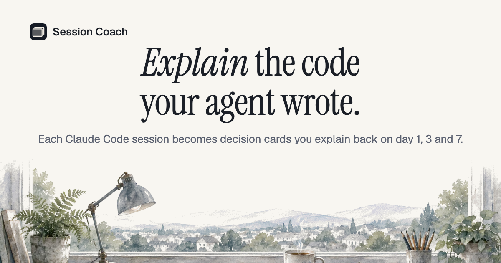

Turns each Claude Code session into up to 5 evidence-backed decision cards, then tests you on the why on day 1, 4 and 11 until you can explain the code your agent wrote.

Built by Kasam Thapa Magar and Zia Ur Rehman Khan for the 8x Playmakers trial (cohort C2, Coding theme), 28 Oct – 6 Nov 2026. Live at [coach.ziaa.me](https://coach.ziaa.me).

## How it works

The full flow. Run `session-coach init` once per project to turn on the hooks in step 1.

1. A Claude Code session ends. The `SessionEnd` hook runs `session-coach sync`, which starts a detached copy of itself and exits, so Claude Code never waits. A `SessionStart` hook catches any session the end missed.
2. The detached `sync` redacts secrets, gzips the log and uploads it in three calls: register the session, `PUT` the log straight to Storage, start processing. `session-coach push --latest` does the same by hand.
3. The server filters the log, numbers the events (E1, E2, …) and one model call extracts up to 5 decisions (none when the session made no real choices).
4. Plain code checks every quote exists in the cited event. Cards with no grounded quote (from a prompt, a reply or `DECISIONS.md`) are dropped.
5. The learner explains each decision in their own words. A model grades it 0 / 1 / 2.
6. The question returns on day 1, 4 and 11. A daily email brings the learner back.

More detail in [docs/ARCHITECTURE.md](docs/ARCHITECTURE.md).

### A session's status

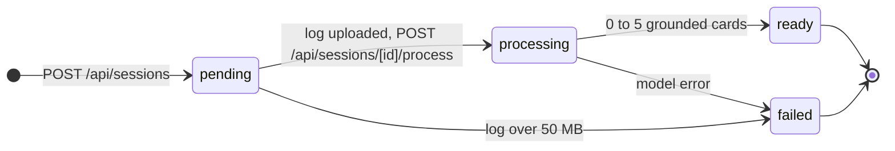

The dashboard updates through Supabase Realtime, so a status change shows without a reload.

### A card's review schedule

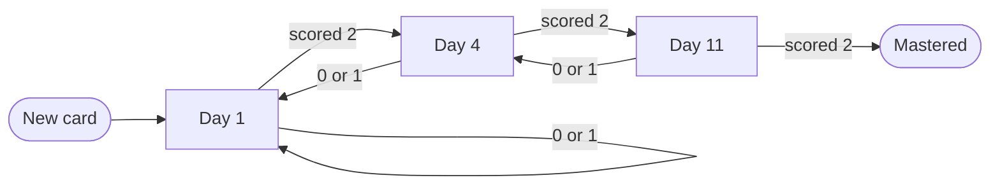

2 is Explained, 1 Partly, 0 Missed. Anything below 2 moves the card one step down (never below day 1) and it comes back tomorrow (`nextReview` in `apps/web/src/lib/review/schedule.ts`).

## Screens

Demo data from `pnpm seed:demo:local`; the graded answer is a real Groq call.

|                                                                                                                                                       |                                                                                                                                                              |
| ----------------------------------------------------------------------------------------------------------------------------------------------------- | ------------------------------------------------------------------------------------------------------------------------------------------------------------ |
| 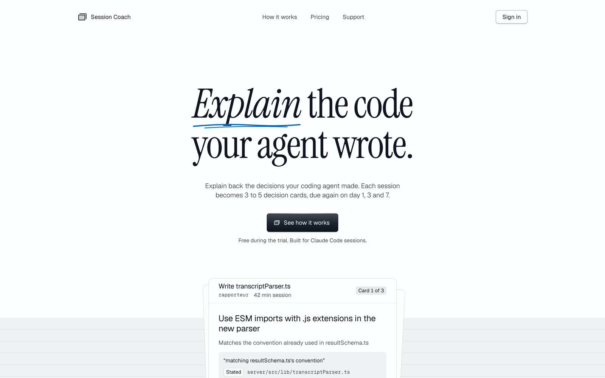                                                | 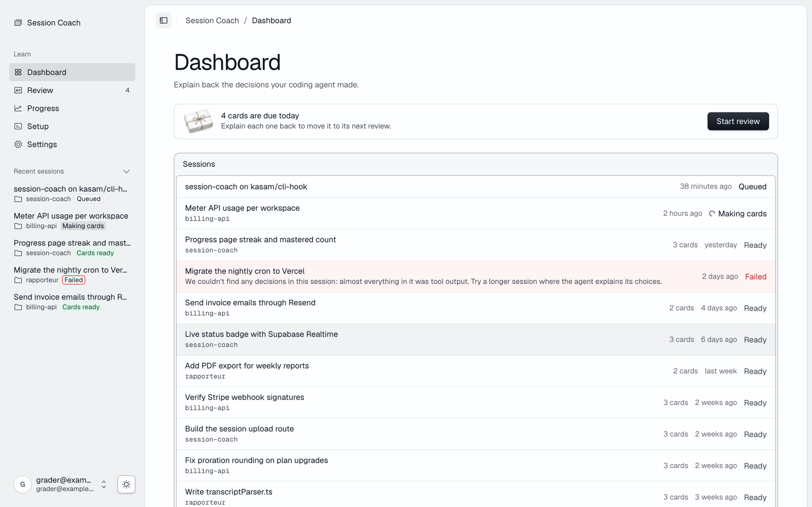 |
| **Landing**                                                                                                                                           | **Dashboard**: due cards and every session's status                                                                                                          |
| 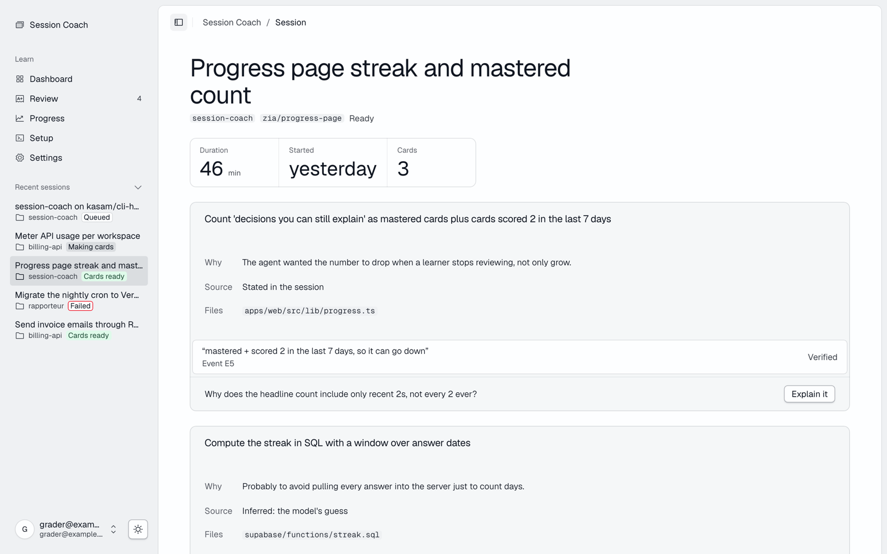 | 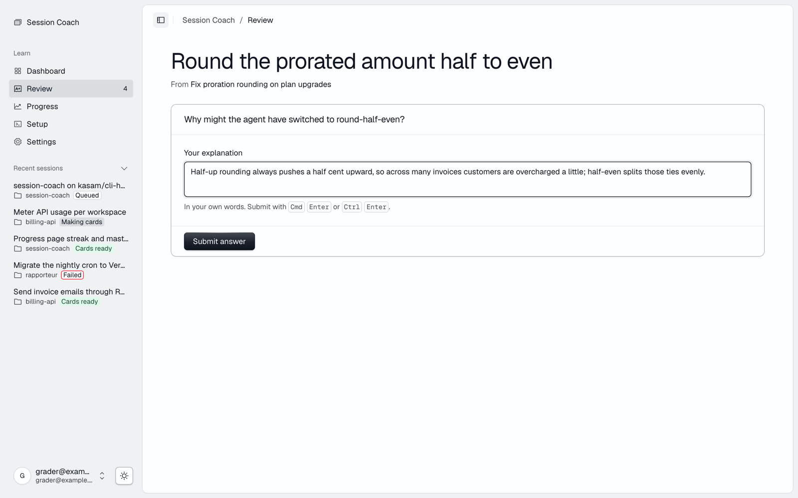                                    |
| **Session, ready**: each card with its why, source and verified quote                                                                                 | **Review**: explain the decision in your own words                                                                                                           |
| 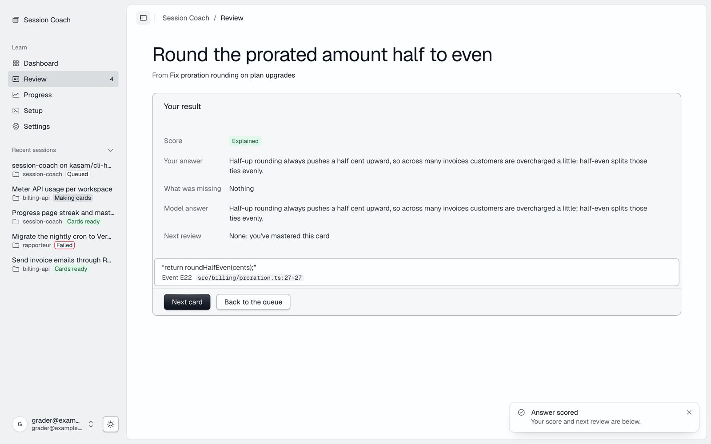              | 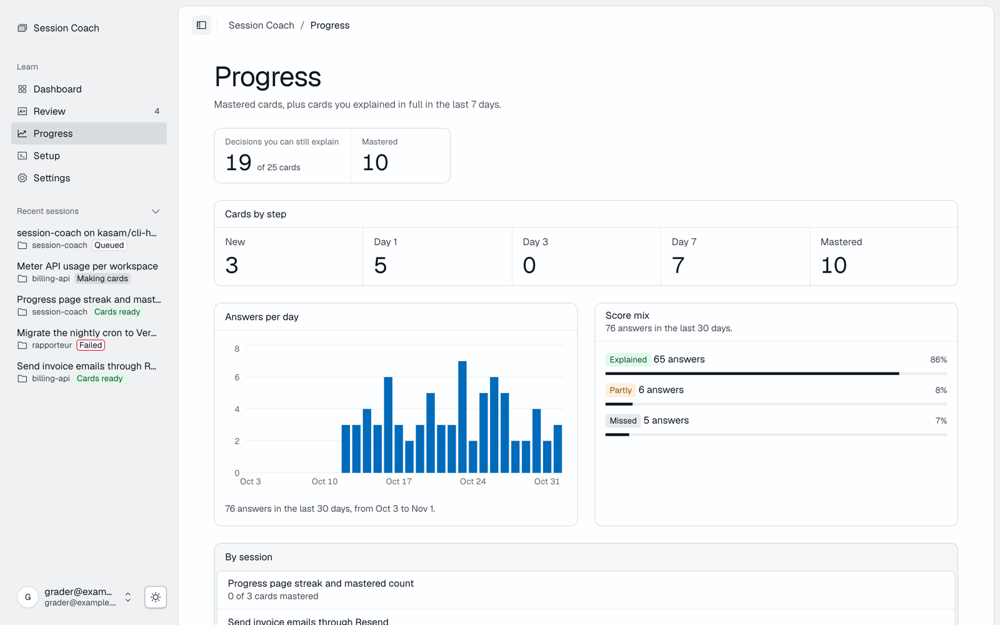              |
| **Result**: the score, what was missing and the next review                                                                                           | **Progress**: cards by step, answers per day, score mix                                                                                                      |
| 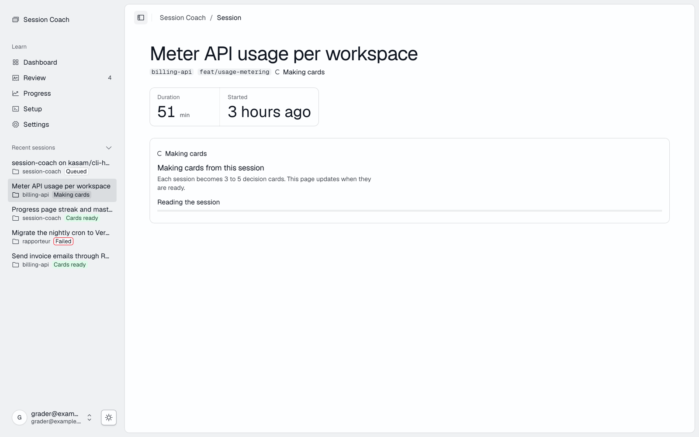                                                        | 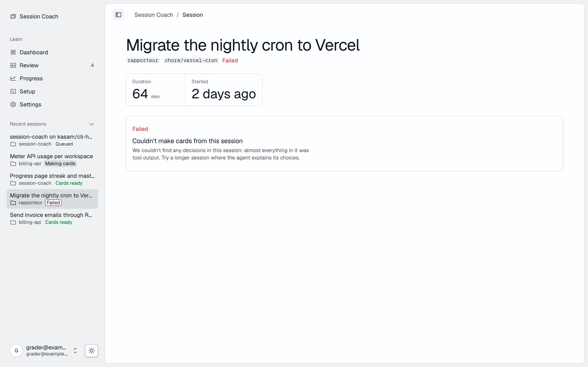                                                               |
| **Session, making cards**                                                                                                                             | **Session, failed**, with the reason                                                                                                                         |
| 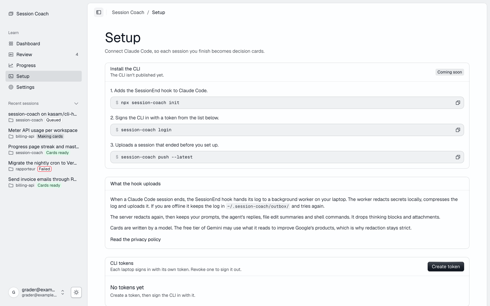                                                    | 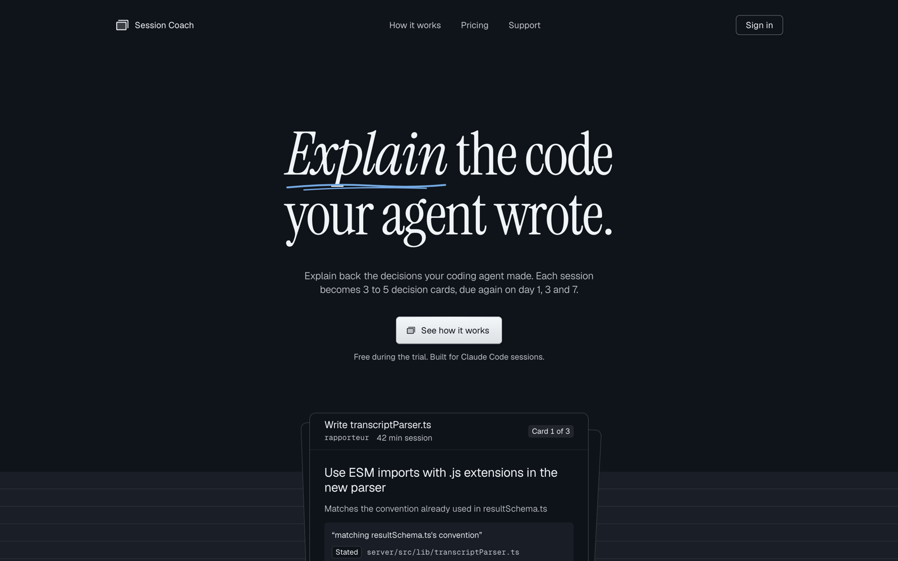                                                                        |
| **Setup**: CLI steps and CLI tokens                                                                                                                   | **Dark mode**                                                                                                                                                |

## Status

| Part                                                                            | State |
| ------------------------------------------------------------------------------- | ----- |
| Web app: auth, dashboard, session pages, review and grading, progress, settings | live  |
| Upload API (`POST /api/sessions`, `POST /api/sessions/[id]/process`)            | live  |
| CLI: `login`, `init`, `push <file>`, `push --latest`, redaction on your machine | live  |
| Card making: parse, extract (Groq), evidence check                              | live  |
| Daily reminder email                                                            | live  |
| `SessionEnd` and `SessionStart` hooks via `init` (upload with no command)       | live  |

## Repo layout

| Path                  | What                                                             | Owner                          |
| --------------------- | ---------------------------------------------------------------- | ------------------------------ |
| `apps/web`            | Next.js app: pages, API routes, pipeline                         | both                           |
| `packages/cli`        | the `session-coach` CLI: `login`, `init`, `push`, `sync`         | Kasam                          |
| `packages/shared`     | Decision and Session types + zod schemas, sample fixture         | shared, change after agreement |
| `supabase/migrations` | every schema change as a migration file                          | shared, change after agreement |
| `docs/`               | architecture, decisions, rules, plans, Play Stats API            | both                           |
| `.claude/`            | agent hooks, settings; `.claude-logs/` holds session transcripts | both                           |

## Run it locally

Needs Node 22.22.2+ or 24.15+ (the LTS lines current Corepack supports). pnpm comes from Corepack, pinned in `package.json`. Older bundled Corepack can't install pnpm 12, so install the latest Corepack first.

```bash
npm install -g corepack@latest
corepack enable pnpm
pnpm install                          # also installs the git hooks in .githooks/
cp .env.example apps/web/.env.local   # fill in values
pnpm dev                              # http://localhost:3000
```

| Command              | What it does                                |
| -------------------- | ------------------------------------------- |
| `pnpm dev`           | start the web app                           |
| `pnpm typecheck`     | TypeScript in every package                 |
| `pnpm lint`          | oxlint + `@shadcn/lint` design-system rules |
| `pnpm test`          | every package's tests                       |
| `pnpm format`        | oxfmt, with the Tailwind class sorter       |
| `pnpm check:secrets` | scan tracked files for credentials          |
| `pnpm build`         | production build                            |

### Against the local Supabase stack

`.env.local` points at the live project. To develop and test against a local database instead (needs Docker):

```bash
supabase start                                  # or `supabase db reset` to reapply the migrations
pnpm db:local                                   # writes apps/web/.env.development.local from `supabase status`
pnpm seed:demo:local --email you@example.test   # demo cards for a learner you created locally
pnpm dev                                        # now uses http://127.0.0.1:54321; auth emails go to Mailpit (:54324)
pnpm db:live                                    # deletes that file: back to .env.local
```

Model keys still come from `.env.local`. Set `MODEL_PROVIDER=fake pnpm dev` to grade without a model. Google sign-in doesn't work locally; use email and password.

| Command         | What it does                                                                        |
| --------------- | ----------------------------------------------------------------------------------- |
| `pnpm test:rls` | two learners on the local stack: each reads only their own rows, can't write grades |
| `pnpm test:e2e` | Playwright smoke: sign in, review a card, see a score (fake model, local stack)     |

Neither runs in `pnpm test`: both need the local stack. CI runs `pnpm test:rls` in its own job; e2e stays local. `pnpm test:e2e` also needs `pnpm --filter web exec playwright install chromium` once.

## Agreed before the repo

| Topic              | Decision                                                                                                                      |
| ------------------ | ----------------------------------------------------------------------------------------------------------------------------- |
| Track              | Coding, saved on the 8x dashboard (theme locked)                                                                              |
| Stack              | Next.js 16 + TypeScript (strict), Tailwind v4, shadcn/ui, Supabase, Vercel                                                    |
| Package manager    | pnpm                                                                                                                          |
| AI                 | `callModel(task, input)`; provider and model names only in env vars. Plan: Gemini free tier, OpenRouter then Groq as fallback |
| Secrets            | `.env.example` committed, real keys never. Service-role key only on the server                                                |
| Daily sync         | Written standup in the team channel. Kasam NPT (UTC+5:45), Zia PKT (UTC+5)                                                    |
| Definition of done | works on a real session, typecheck + lint pass, reviewed by the other person, merged, demo-able                               |

## Working together

- `main` is protected: pull request required, 1 approving review, no force pushes, no direct pushes (admins included).
- One small branch per task: `kasam/parser`, `zia/review-screen`.
- Before the PR: sync `main`, run `pnpm typecheck && pnpm lint`, test on a real session.
- PR says what changed, why, and how to test it. The other person reviews within a few hours.
- Shared types and migrations change only after a message in the team channel.
- Team decisions go in [docs/DECISIONS.md](docs/DECISIONS.md) with a date and a reason.
